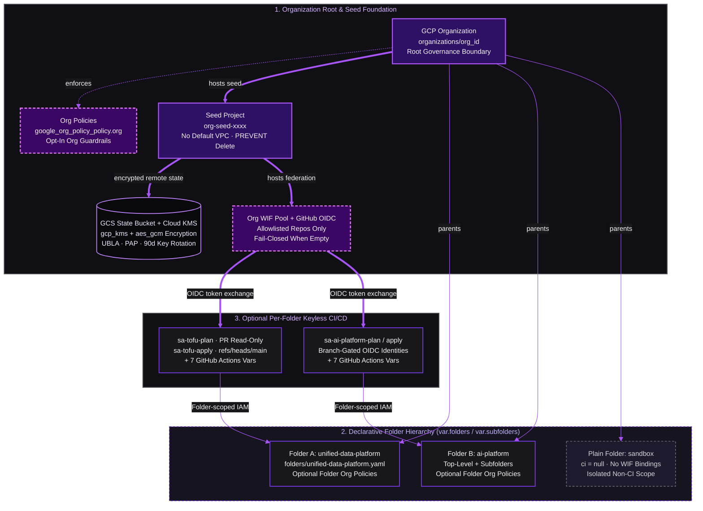

# GCP Organization Bootstrap (`platform_gcp_org_bootstrap`)

Generalized OpenTofu Organization-level landing zone foundation for Google Cloud, governed by [Spec 01: GCP Org Bootstrap, Multi-Folder Governance, KMS State & Keyless WIF](./specs/01_gcp_org_bootstrap_and_wif.md). Manages the Organization Seed project, Cloud KMS-encrypted GCS remote state, an org-wide GitHub OIDC Workload Identity Federation (WIF) pool, declarative multi-tier GCP Folders (`var.folders` + `var.subfolders`), optional per-folder keyless CI/CD identities & GitHub Actions variables, and Organization/Folder-level GCP Organization Policies (`google_org_policy_policy`).

> **Scope Boundary:** This repository strictly owns **Org-level and Folder-level foundations**. Workload/environment projects (such as `udp-dev`, `uat`, `prod`), VPCs, and billing budgets live in downstream platform repositories (e.g., `platform_unified_data_gcp/infra/platform` & `infra/envs`).

## Key Capabilities

- **Multi-Folder & Subfolder Hierarchy (`folders.tf`):** Declare any number of top-level folders under `organizations/<org_id>` (`var.folders`) and second-level child folders (`var.subfolders`) with per-folder `deletion_protection`.
- **Declarative Organization & Folder Policies (`org_policies.tf`):** Manage boolean and list-based GCP Organization Policies (`google_org_policy_policy`) at Organization, top-level Folder, and Subfolder scopes (opt-in by default).
- **Hardened Org Seed & Client-Side Encrypted State (`main.tf`, `encryption.tf`):** Provisions a dedicated Seed GCP project (`auto_create_network = false`, `deletion_policy = "PREVENT"`), versioned GCS state bucket (UBLA + PAP enforced, lifecycle retention, `prevent_destroy = true`), and Cloud KMS KeyRing/CryptoKey (90-day rotation, `prevent_destroy = true`) driving OpenTofu native `gcp_kms` + `aes_gcm` state encryption.
- **Keyless Per-Folder GitOps WIF (`iam_wif.tf`, `github_actions.tf`):** Shares one org-wide WIF Pool & GitHub OIDC Provider restricted to the exact set of authorized repositories (failing closed when empty). Any folder opting into `ci = { ... }` receives isolated `plan` (read-only + conditional `.tflock`-only GCS lock) and `apply` (branch-gated to `refs/heads/<apply_branch>`) Service Accounts scoped strictly to that folder, plus 7 org-owned GitHub Actions repository variables.

## Architecture Overview



## Repository Layout

```text
platform_gcp_org_bootstrap/
├── .agents/skills/
│   └── folder-onboarding/     # Repo-local Antigravity skill: interactive folder onboarding + PR
├── .github/workflows/ci.yml   # Format, validate, TFLint, Trivy, script & OpenTofu mocked tests
├── folders/                   # Git-tracked declarative folder manifests (one YAML per folder)
│   └── unified-data-platform.yaml
├── specs/
│   └── 01_gcp_org_bootstrap_and_wif.md  # Org bootstrap, multi-folder, Org Policies & WIF contract
├── scripts/
│   ├── bootstrap_init.sh      # Automated Org IAM preflight, ADC check, tfvars scaffold & tofu apply
│   ├── test_bootstrap_init.sh # Offline mocked unit tests for bootstrap_init.sh
│   ├── onboard_folder.sh      # Interactive/CLI folder onboarding & graduated-repo re-bind + PR helper
│   └── test_onboard_folder.sh # Offline mocked unit tests for onboard_folder.sh
├── tests/
│   └── bootstrap.tftest.hcl   # Offline mocked OpenTofu unit tests (folders, WIF, policies, validations)
├── main.tf                    # Seed project, required APIs, hardened GCS state bucket, Cloud KMS
├── folders.tf                 # Top-level folders & second-level subfolders
├── org_policies.tf            # Org-level, folder-level & subfolder-level google_org_policy_policy
├── iam_wif.tf                 # Org WIF Pool/OIDC Provider + per-folder plan/apply SAs & IAM
├── github_actions.tf          # 7 org-owned GitHub Actions variables per CI-enabled folder
├── backend.tf                 # GCS remote state backend (prefix = "bootstrap")
├── encryption.tf              # Enforced OpenTofu gcp_kms + aes_gcm state/plan encryption
├── variables.tf               # Typed inputs & regex validation contracts
├── outputs.tf                 # Seed, KMS, WIF, folder_ids, subfolder_ids & folder_ci_identities
├── versions.tf                # OpenTofu >= 1.8, google ~> 6.0, random ~> 3.6, github ~> 6.0
├── terraform.tfvars.example   # Annotated configuration template (gitignored real terraform.tfvars)
├── .tflint.hcl                # TFLint Google ruleset config
└── .trivyignore               # Documented Trivy IaC suppressions (empty)
```

## Prerequisites

```bash
brew install opentofu trivy terraform-linters/tap/tflint
gcloud auth login && gcloud auth application-default login
gh auth login
```

## Quick Start (Fresh GCP Organization)

### Phase 1: Automated Org IAM Preflight & Initial Apply

> **External / Personal Billing Account:** If your Billing Account lives outside your GCP Organization (e.g., under a personal `@gmail.com` account), grant your Org Admin identity `roles/billing.admin` directly on the Billing Account once from the billing owner's account before running `bootstrap_init.sh`.

For a brand-new GCP Org without an existing remote state bucket yet, temporarily comment out `backend.tf` and `encryption.tf` for the initial local apply, then run `scripts/bootstrap_init.sh`:

```bash
# Preview planned Org IAM bindings, terraform.tfvars, and tofu commands (zero mutations)
./scripts/bootstrap_init.sh --dry-run

# Run preflight (binds folderAdmin, projectCreator, billing.admin, orgpolicy.policyAdmin) and apply
./scripts/bootstrap_init.sh
```

> Re-running `scripts/bootstrap_init.sh` preserves any existing `terraform.tfvars` (including your `folders`, `subfolders`, and `org_policies` maps) unless `--overwrite-tfvars` is passed.

### Phase 2: Migrate Bootstrap State to Cloud KMS-Encrypted GCS

1. Restore `backend.tf` (`prefix = "bootstrap"`) and temporarily set `enforced = false` with an `unencrypted` fallback in `encryption.tf`.
2. Grant your Org Admin identity `roles/cloudkms.cryptoKeyEncrypterDecrypter` on the created KMS key and migrate state:
   ```bash
   STATE_BUCKET="$(tofu output -raw state_bucket_name)"
   export TF_VAR_state_kms_key_id="$(tofu output -raw kms_key_id)"

   gcloud kms keys add-iam-policy-binding "${TF_VAR_state_kms_key_id}" \
     --member="user:$(gcloud config get-value account)" \
     --role="roles/cloudkms.cryptoKeyEncrypterDecrypter"

   tofu init -migrate-state -backend-config="bucket=${STATE_BUCKET}"
   ```
3. Verify the remote object is encrypted ciphertext (`gcloud storage cat "gs://${STATE_BUCKET}/bootstrap/default.tfstate" | head -c 200`), restore `enforced = true` in `encryption.tf`, remove local `terraform.tfstate*`, and run `tofu plan` to confirm zero diff.

## Onboarding Folders, Updating Graduated Repos & Organization Policies

> **Important — How `ci.github_repository` Works:**
> `folders/<folder-key>.yaml` files are **Git-tracked** (containing zero secrets or Org/Billing IDs) and loaded automatically by `folders.tf`. When a folder opts into `ci`, its `ci.github_repository` points to the **downstream GitOps repository that deploys into that folder**—not `platform_gcp_org_bootstrap` itself. For example, [`folders/unified-data-platform.yaml`](./folders/unified-data-platform.yaml) currently points to `x-ruiz/playground-cloud-engineering` because `platform_unified_data_gcp` still deploys from there.
>
> **Every time you onboard a new GCP Folder OR graduate a downstream project into its own standalone repository**, you MUST add or update its `folders/<folder-key>.yaml` manifest here (and apply after merging) so WIF allowlists the new repository, binds its folder-scoped Plan/Apply SAs, and syncs the 7 org-owned GitHub Actions variables to it.

### Option A: Automated Onboarding Script (`scripts/onboard_folder.sh`)

```bash
# Interactive onboarding (prompts for folder key, display name, optional CI repo & prefix)
./scripts/onboard_folder.sh --open-pr

# Non-interactive: onboard a new platform folder + open a PR
./scripts/onboard_folder.sh \
  --non-interactive \
  --folder-key ai-platform \
  --display-name "AI Platform" \
  --github-repo x-ruiz/platform-ai-gcp \
  --var-prefix AI_GCP \
  --open-pr

# Plain folder without CI/WIF bindings
./scripts/onboard_folder.sh --non-interactive --folder-key sandbox --deletion-protection false --no-ci --open-pr

# Re-bind an existing folder after its downstream project graduates to a standalone repo
./scripts/onboard_folder.sh \
  --non-interactive \
  --update \
  --folder-key unified-data-platform \
  --github-repo x-ruiz/platform-unified-data \
  --open-pr
```

### Option B: Repo-Local Antigravity Skill (`folder-onboarding`)

Opening this repository in Antigravity automatically exposes the repo-local **[`folder-onboarding`](./.agents/skills/folder-onboarding/SKILL.md)** skill. Ask *"onboard a new GCP folder"* or *"update the repo for unified-data-platform"*—the agent will collect the required inputs, generate/update `folders/<folder-key>.yaml`, run the full local verification suite, and open a PR automatically.

### Option C: Manual YAML Manifest (`folders/<folder-key>.yaml`)

Create a new file under `folders/<folder-key>.yaml` (supports optional `subfolders` and folder-scoped `org_policies` directly inside the same file):

```yaml
# folders/data-platform.yaml
display_name: "data-platform"
deletion_protection: true

ci:
  github_repository: "x-ruiz/platform-data-gcp"
  apply_branch: "main"
  github_var_prefix: "DATA_GCP"

subfolders:
  data-nonprod:
    display_name: "nonprod"

org_policies:
  "gcp.resourceLocations":
    rules:
      - allowed_values: ["in:us-locations"]
```

Org-level policies (`org_policies`) are configured in your local `terraform.tfvars` (see [`terraform.tfvars.example`](./terraform.tfvars.example)). After your folder PR merges to `main`, apply locally as Org Admin:

```bash
export TF_VAR_state_kms_key_id="<existing-kms-key-id>"
export GITHUB_TOKEN="$(gh auth token)"
tofu plan && tofu apply
```

### Synced GitHub Actions Variables (Per CI-Enabled Folder)

When `ci.sync_github_vars = true` (default), OpenTofu manages these 7 org-owned variables on `ci.github_repository` using `ci.github_var_prefix`:

| Variable | Source |
| :--- | :--- |
| `<PREFIX>_WIF_PROVIDER` | Org-wide GitHub OIDC WIF provider path |
| `<PREFIX>_PLAN_SA` | Folder-scoped read-only plan SA email |
| `<PREFIX>_APPLY_SA` | Folder-scoped branch-gated apply SA email |
| `<PREFIX>_STATE_BUCKET` | Org Seed GCS state bucket name |
| `<PREFIX>_STATE_KMS_KEY_ID` | Cloud KMS CryptoKey ID for `gcp_kms` state encryption |
| `<PREFIX>_<FOLDER_ID_SUFFIX>` | Created folder ID (`folders/<id>`, default suffix `FOLDER_ID`) |
| `<PREFIX>_BILLING_ACCOUNT_ID` | GCP Billing Account ID |

## Quality & Offline Verification

All static checks, security scans, and mocked unit tests run locally with zero GCP credentials or cost:

```bash
tofu fmt -check -recursive -diff .
tofu init -backend=false -input=false
tofu validate
tflint --init --config="$(pwd)/.tflint.hcl"
tflint --recursive --config="$(pwd)/.tflint.hcl"
trivy config --severity HIGH,CRITICAL --exit-code 1 --skip-dirs '**/.terraform' --skip-dirs '**/.tofu' .
bash -n scripts/bootstrap_init.sh && bash scripts/test_bootstrap_init.sh
bash -n scripts/onboard_folder.sh && bash scripts/test_onboard_folder.sh
tofu test -verbose
```
