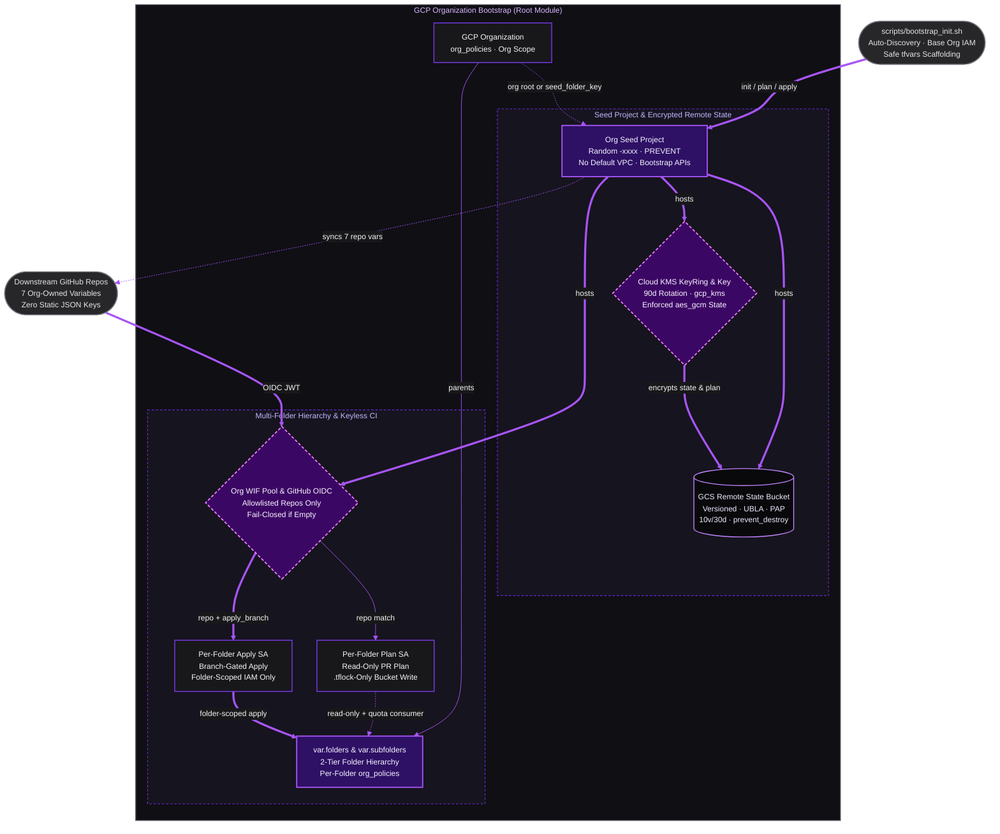

# Spec 01: GCP Org Bootstrap, Multi-Folder Governance, KMS State & Keyless WIF

| Field | Value |
| :--- | :--- |
| **Status** | `Approved` *(Graduated from `playground-cloud-engineering/platform_unified_data_gcp`)* |
| **Owner** | Xavier Ruiz |
| **Component** | `platform_gcp_org_bootstrap/` root module + `scripts/bootstrap_init.sh` |
| **Stack** | OpenTofu `>= 1.8.0, < 2.0.0` · `hashicorp/google ~> 6.0` · `hashicorp/random ~> 3.6` · `integrations/github ~> 6.0` |
| **Archetype / Tier** | Infrastructure-as-Code & GitOps (Org Bootstrap & Landing Zone) · Full Spec (`7 REQs`, `7 TCs`) |

---

## 1. Overview & Design

### TL;DR
Before any downstream platform or workload repository can deploy environments autonomously via GitOps, a GCP Organization needs a hardened bootstrap foundation. This spec establishes the Organization Seed project, client-side Cloud KMS-encrypted GCS remote state, declarative two-tier GCP Folders and Organization Policies, an org-wide keyless GitHub OIDC Workload Identity Federation (WIF) pool with isolated per-folder CI Service Accounts, and 7 org-owned GitHub Actions variables per CI folder—automated through a safe local preflight script.

### Architecture

### Key Design Decisions
- **Keyless OIDC federation with fail-closed allowlist:** One org-wide WIF pool federates only explicitly configured GitHub repositories and rejects all tokens (`"false"`) when empty, eliminating static JSON keys.
- **Strict folder-scoped dual CI identities:** Each CI-enabled folder receives a read-only `plan` SA and a branch-gated `apply` SA (`refs/heads/<apply_branch>`) with zero Organization-level IAM roles.
- **Enforced client-side KMS state encryption:** Native OpenTofu `gcp_kms` + `aes_gcm` encryption (`enforced = true`) protects remote state and plans without permitting plaintext fallback.
- **Clean Org vs. Platform ownership boundary:** Org bootstrap manages strictly the 7 org-owned GitHub variables per CI folder while leaving environment project IDs and budget alert emails to downstream platform repositories.

### Done Looks Like
- `tofu fmt -check -recursive`, `tofu validate`, `tflint --recursive`, `trivy config` (`HIGH,CRITICAL`), offline `tofu test`, and `scripts/test_bootstrap_init.sh` all exit `0`.
- Live apply produces an encrypted GCS state object with zero diff on re-plan, and `TC-001`–`TC-007` pass.

---

## 2. Scope

### In Scope
- Automate local preflight setup (`scripts/bootstrap_init.sh`) with offline mocked tests (`scripts/test_bootstrap_init.sh`) covering metadata auto-discovery, base Org IAM bindings, Billing/ADC checks, safe `terraform.tfvars` preservation, and OpenTofu execution.
- Provision the hardened Org Seed project under `org_id` (or optional `seed_folder_key`), linked to `billing_account_id`, with required bootstrap APIs including `orgpolicy.googleapis.com`.
- Provision a hardened GCS remote state bucket paired with a Cloud KMS KeyRing and 90-day-rotating CryptoKey driving enforced OpenTofu `gcp_kms` + `aes_gcm` state and plan encryption.
- Manage a declarative two-tier GCP Folder hierarchy (`var.folders` + optional `var.subfolders`) with configurable deletion protection and opt-in Organization/Folder Policies.
- Provision an org-wide GitHub OIDC WIF pool, optional per-folder dual CI Service Accounts (`plan` and `apply`) with folder-scoped IAM, and strictly the 7 org-owned GitHub Actions variables per CI folder when `sync_github_vars = true`.

### Out of Scope (Non-Goals)
- **Workload & environment projects:** Environment projects (`dev`/`uat`/`prod`), VPCs, budgets, and platform-specific GitHub variables (`*_DEV_PROJECT_ID`, `*_BUDGET_ALERT_EMAIL`) belong exclusively in downstream platform repositories.
- **Static credentials:** Zero `google_service_account_key` resources or long-lived GCP JSON secrets anywhere in code or CI.
- **Data-layer workloads:** BigQuery, BigLake, Dataproc, Composer, and medallion buckets belong in downstream platform repositories.
- **One-time state migration mechanics:** Any temporary state-adoption shims belong in migration runbooks/PRs, not this evergreen contract.

---

## 3. Functional Requirements

Exact parameter names, defaults, and constraints live once in **Section 4**.

### Foundation, State & Governance

| ID | What | Why | How |
| :--- | :--- | :--- | :--- |
| `REQ-01` | Toolchain & version pinning | Prevents provider drift and guarantees reproducible applies | Pin OpenTofu `>= 1.8.0, < 2.0.0`, `google ~> 6.0`, `random ~> 3.6`, `github ~> 6.0`, and commit `.terraform.lock.hcl` |
| `REQ-02` | Org Seed project & folder hierarchy | Isolates bootstrap state from workloads and structures downstream platforms | Provision hardened Seed project (no default VPC, random `-xxxx`, `PREVENT`, mandatory labels, bootstrap APIs) + 2-tier folders with deletion protection |
| `REQ-03` | Hardened state bucket & KMS encryption | Protects remote state from deletion, public exposure, or plaintext storage | Versioned GCS bucket (UBLA, PAP enforced, 10v/30d noncurrent retention, `prevent_destroy`) + 90d-rotating KMS key enforcing `gcp_kms` + `aes_gcm` |
| `REQ-04` | Declarative Org & Folder policies | Codifies GCP guardrails while remaining opt-in by default | Manage boolean, list, and conditional Organization Policies across Org, Folder, and Subfolder scopes |

### Keyless Federation, GitHub Sync & Preflight

| ID | What | Why | How |
| :--- | :--- | :--- | :--- |
| `REQ-05` | Keyless Org WIF & dual per-folder CI SAs | Eliminates static keys and isolates CI blast radius per folder and branch | One org-wide WIF Pool & GitHub OIDC Provider allowlisting configured repos (failing closed when empty) + per-folder read-only `plan` and branch-gated `apply` SAs |
| `REQ-06` | Org-owned GitHub Actions variables | Delivers bootstrap coordinates to downstream repos without owning platform env vars | When `sync_github_vars = true`, manage strictly the 7 org-owned GitHub Actions variables per CI folder (§4.1) |
| `REQ-07` | Automated bootstrap preflight script | Prevents manual CLI mistakes while preserving hand-edited multi-folder configs | `scripts/bootstrap_init.sh` validates tools/inputs, binds base Org IAM (§4.4), verifies Billing & ADC, preserves existing `terraform.tfvars` by default, and runs OpenTofu |

---

## 4. Contract & Blueprint

### 4.1 Provisioned Core Resources & GitHub Variables

| Resource | Contract & Guardrails |
| :--- | :--- |
| **Org Seed Project** | Under `org_id` or `seed_folder_key`; random `-xxxx` suffix; no default VPC; bootstrap APIs incl. `orgpolicy.googleapis.com`; mandatory labels; `deletion_policy = "PREVENT"` |
| **GCS Remote State Bucket** | Versioning enabled; UBLA; PAP `enforced`; noncurrent retention (10 versions / 30 days); `force_destroy = false`; `prevent_destroy = true` |
| **Cloud KMS KeyRing & Key** | 90-day rotation; `prevent_destroy = true`; drives OpenTofu `gcp_kms` + `aes_gcm` (`enforced = true`) |
| **Multi-Folder Hierarchy** | Top-level `var.folders` + 2nd-level `var.subfolders`; `deletion_protection = true` default; opt-in Organization Policies (`{}` default) |
| **Org WIF Pool & OIDC** | Single org-wide pool + GitHub OIDC provider; allowlists configured repos and fails closed (`"false"`) when empty |
| **GitHub Actions Variables** | Strictly 7 per CI folder (`sync_github_vars = true`): `<PREFIX>_WIF_PROVIDER`, `_PLAN_SA`, `_APPLY_SA`, `_STATE_BUCKET`, `_STATE_KMS_KEY_ID`, `_<FOLDER_ID_SUFFIX>`, `_BILLING_ACCOUNT_ID` |
| **Preflight Script** | Supports default run, `--dry-run` (zero mutations), `--skip-apply`, `--auto-approve`, and `--overwrite-tfvars` |

### 4.2 Root Module Inputs

| Input | Type | Default | Constraint |
| :--- | :--- | :--- | :--- |
| `org_id` | `string` | *required* | Numeric GCP Org ID (`^[0-9]+$`) |
| `billing_account_id` | `string` | *required* | `^[A-Z0-9]{6}-[A-Z0-9]{6}-[A-Z0-9]{6}$` |
| `github_owner` | `string` | *required* | GitHub org or username owning CI repositories |
| `bootstrap_name` | `string` | `"gcp-org-bootstrap"` | Lowercase slug for labels & default KMS KeyRing |
| `kms_key_ring_name` | `string` | `null` | Optional override for adopting an existing live KeyRing |
| `seed_project_id` | `string` | *required* | Base prefix (4–25 chars); `-xxxx` suffix appended |
| `seed_project_name` | `string` | `"Org Bootstrap Seed"` | Display name (4–30 chars) |
| `seed_folder_key` | `string` | `null` | Optional key in `var.folders` (defaults to Org root) |
| `region` | `string` | `"us-central1"` | Primary GCP region for Seed bucket & KMS |
| `cost_center` | `string` | `"platform-engineering"` | Mandatory `cost_center` label value |
| `state_kms_key_id` | `string` | *required* | Cloud KMS CryptoKey ID for `gcp_kms` encryption |
| `folders` | `map(object)` | `{}` | Top-level folders with optional `ci` & `org_policies` |
| `subfolders` | `map(object)` | `{}` | 2nd-level folders with optional `org_policies` |
| `org_policies` | `map(object)` | `{}` | Organization-level policy rules |

### 4.3 Root Module Outputs

| Output | Format / Value | Consumer |
| :--- | :--- | :--- |
| `seed_project_id` | Provisioned Seed GCP project ID (with `-xxxx`) | Diagnostics & state audit |
| `state_bucket_name` | Seed GCS remote state bucket name | Downstream Terragrunt & GitHub vars |
| `kms_key_id` | Cloud KMS CryptoKey resource ID | OpenTofu `gcp_kms` & GitHub vars |
| `wif_provider_name` | Org WIF GitHub OIDC provider resource name | Downstream GitHub Actions workflows |
| `folder_ids` | Map of top-level folder IDs (`folders/<id>`) | Downstream platform stacks & GitHub vars |
| `subfolder_ids` | Map of 2nd-level subfolder IDs (`folders/<id>`) | Sub-domain platform stacks |
| `folder_ci_identities` | Map of per-folder `plan` & `apply` SA emails | Downstream GitHub Actions & audit |

### 4.4 IAM & WIF Principal Matrix

| Principal & Condition | Scope | Assigned Roles | Purpose |
| :--- | :--- | :--- | :--- |
| `folder_plan[k]` (`repository == ci.github_repository`) | Target Folder `k` | `viewer`, `iam.securityReviewer`, `serviceusage.serviceUsageConsumer` (configurable) | Read-only PR plan + API quota billing to env projects |
| `folder_plan[k]` (same repo) | State Bucket & KMS | `storage.objectViewer`, conditional `.tflock`-only `objectUser`, `cloudkms.cryptoKeyEncrypterDecrypter` | Encrypted state init + lock handling without state write |
| `folder_apply[k]` (`repository_ref == <repo>:refs/heads/<apply_branch>`) | Target Folder `k` | `projectCreator`, `projectDeleter`, `projectIamAdmin`, `compute.networkAdmin`, `serviceUsageAdmin`, `monitoring.notificationChannelEditor` (configurable) | Provision env projects & infra inside folder `k` only |
| `folder_apply[k]` (same branch) | Billing, Bucket & KMS | Optional `billing.user`/`billing.costsManager`, `storage.objectUser`, `cloudkms.cryptoKeyEncrypterDecrypter` | Link projects, manage budgets & write encrypted state |
| Local Operator (`bootstrap_init.sh`) | Organization | `folderAdmin`, `projectCreator`, `billing.admin`, `orgpolicy.policyAdmin` | One-time Org bootstrap execution |

---

## 5. Invariants & Failure Modes

### Key Invariants
- **Zero Org-wide CI blast radius:** No folder CI Service Account holds Organization-level IAM roles, and WIF fails closed (`"false"`) when no repositories are authorized.
- **Zero static credentials:** No `google_service_account_key` resources or JSON keys exist anywhere in code or CI.
- **Destruction guardrails:** Seed project (`PREVENT`), state bucket (`force_destroy = false`, `prevent_destroy = true`), KMS key (`prevent_destroy = true`), and folders (`deletion_protection = true` default) reject accidental destroys.
- **Org vs. Platform ownership boundary:** Platform environment variables (`*_DEV_PROJECT_ID`, `*_BUDGET_ALERT_EMAIL`) are never managed in this repository.

### Failure Modes

| Condition | Expected Behavior | Guarantee |
| :--- | :--- | :--- |
| Invalid `org_id`, `billing_account_id`, `seed_project_id`, or `ci.github_repository` | OpenTofu validation error (or script exit `2`) | Fails fast before any GCP API call or file write |
| Non-`apply_branch` attempts to impersonate `folder_apply[k]` | GCP STS `403 PERMISSION_DENIED` | Enforced server-side by WIF principal binding |
| Missing `roles/billing.admin` on external Billing Account or mismatched ADC | `bootstrap_init.sh` exit `1` (or ADC refresh prompt) | Prints remediation before running `tofu apply` |
| `tofu init` without KMS decrypt permission | OpenTofu `Failed to decrypt state` | Fail-closed (`enforced = true`); rejects plaintext state |

---

## 6. Acceptance & Verification (`TC-*`)

| Case | Scenario | Pass Condition |
| :--- | :--- | :--- |
| `TC-001` (`REQ-01`) | Static hygiene & security scan | `tofu fmt -check`, `tofu validate`, `tflint --recursive`, and `trivy config` exit `0` with zero HIGH/CRITICAL findings. |
| `TC-002` (`REQ-02`–`06`) | Multi-folder, WIF & Org Policy invariants (Mocked) | `tofu test` verifies Seed hardening, bucket UBLA/PAP/versioning, 90d KMS rotation, multi-folder + subfolder creation, allowlisted WIF, strictly 7 org-owned GitHub vars per CI folder, and boolean/list Org & Folder Policies. |
| `TC-003` (`REQ-02`, `REQ-03`, `REQ-05`) | Single-repo compatibility & fail-closed zero-repo WIF (Mocked) | Single-repo config honors `seed_folder_key` / `kms_key_ring_name`; zero-repo config sets WIF condition to `"false"`. |
| `TC-004` (`REQ-02`, `REQ-05`) | Input validation negative tests (Mocked) | Invalid `org_id` and malformed `ci.github_repository` fail plan via `expect_failures`. |
| `TC-005` (`REQ-03`, `REQ-06`) | Live apply & KMS state encryption | Encrypted GCS state verified (ciphertext, zero plaintext fallback) and subsequent `tofu plan` yields zero diff. |
| `TC-006` (`REQ-07`) | Preflight script happy path & modes (Mocked) | `scripts/test_bootstrap_init.sh` verifies auto-discovery, Org IAM, decoupled `tfvars`, `--skip-apply`, `--auto-approve`, and exit `2`/`1` negative paths. |
| `TC-007` (`REQ-07`) | Preflight dry-run & `tfvars` preservation (Mocked) | `--dry-run` performs zero mutations; re-running against an existing `terraform.tfvars` preserves custom `folders` and `org_policies` maps untouched. |
