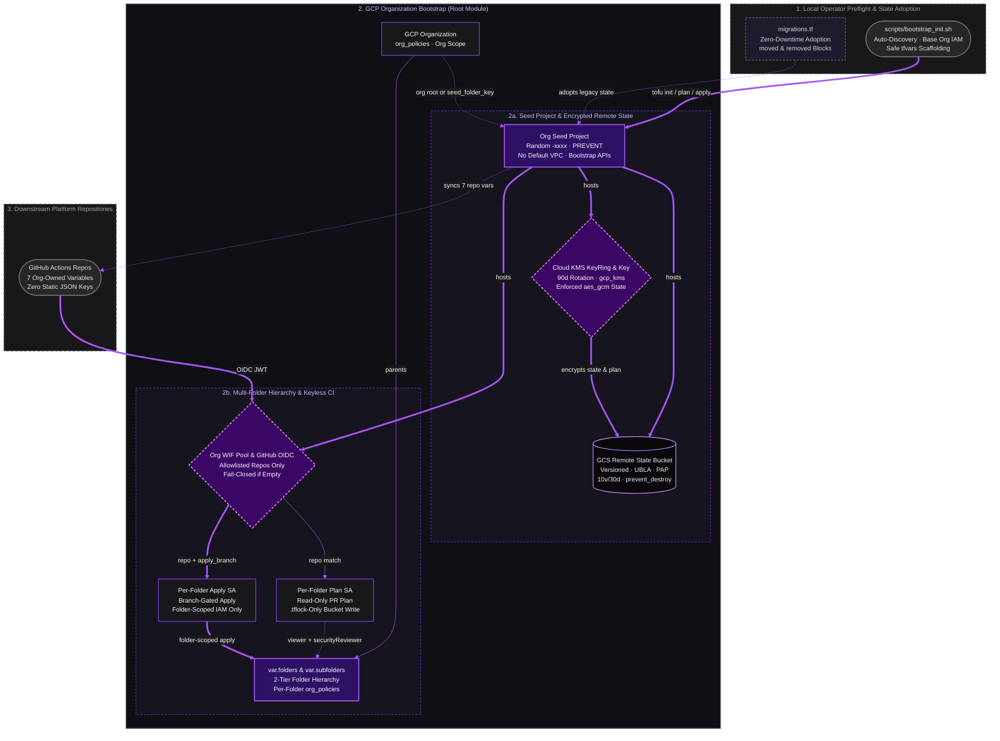

# Spec 01: GCP Org Bootstrap, Multi-Folder Governance, KMS State & Keyless WIF

| Field | Value |
| :--- | :--- |
| **Status** | `Approved` *(Graduated from `playground-cloud-engineering/platform_unified_data_gcp`)* |
| **Owner** | Xavier Ruiz |
| **Component** | `platform_gcp_org_bootstrap/` root module + `scripts/bootstrap_init.sh` |
| **Stack** | OpenTofu `>= 1.8.0, < 2.0.0` · `hashicorp/google ~> 6.0` · `hashicorp/random ~> 3.6` · `integrations/github ~> 6.0` |
| **Archetype / Tier** | Infrastructure-as-Code & GitOps (Org Bootstrap & Landing Zone) · Full Spec (`7 REQs`, `7 TCs`) |

---

## 1. Overview & Design

### TL;DR
Before any downstream platform or workload repository can deploy environments autonomously via GitOps, a GCP Organization needs a hardened, reusable bootstrap foundation. This spec establishes the Organization Seed project, client-side Cloud KMS-encrypted GCS remote state, declarative two-tier GCP Folders and Organization Policies, an org-wide keyless GitHub OIDC Workload Identity Federation (WIF) pool with isolated per-folder CI Service Accounts, and 7 org-owned GitHub Actions variables per CI folder—automated through a safe local preflight script and zero-downtime migration bridge.

### Architecture

### Key Design Decisions
- **Keyless OIDC federation with fail-closed allowlist:** One org-wide WIF pool federates only explicitly configured GitHub repositories and evaluates `attribute_condition` to `"false"` when empty, eliminating static JSON keys.
- **Strict folder-scoped dual CI identities:** Each CI-enabled folder receives a read-only `plan` SA and a branch-gated `apply` SA (`refs/heads/<apply_branch>`) with zero Organization-level IAM roles.
- **Enforced client-side KMS state encryption:** Native OpenTofu `gcp_kms` + `aes_gcm` encryption (`enforced = true`) protects remote state and plans without permitting plaintext fallback.
- **Clean Org vs. Platform ownership boundary:** Org bootstrap manages strictly the 7 org-owned GitHub variables per CI folder while leaving environment project IDs and budget alert emails to downstream platform repositories.

### Done Looks Like
- Every static check, security scan, offline OpenTofu test, and preflight script test in the Verification Gates table passes with zero findings.
- Live apply plus two-phase Cloud KMS state migration (or zero-downtime `migrations.tf` state adoption) produces an encrypted GCS state object and zero diff on re-plan.
- Acceptance cases `TC-001` through `TC-007` are verified.

| Gate | Command | Scope |
| :--- | :--- | :--- |
| Formatting & Schema | `tofu fmt -check -recursive` · `tofu validate` | Root module |
| Lint & Security | `tflint --recursive` · `trivy config` (`HIGH,CRITICAL`) | Root module |
| Module Unit Tests | `tofu test` (`mock_provider`) | Offline OpenTofu test suite |
| Preflight Script Tests | `scripts/test_bootstrap_init.sh` | Offline mocked `bootstrap_init.sh` suite |

---

## 2. Scope

### In Scope
- Automate local preflight setup with `scripts/bootstrap_init.sh` and offline verification in `scripts/test_bootstrap_init.sh`, covering metadata auto-discovery, base Org IAM bindings, Billing/ADC checks, safe `terraform.tfvars` scaffolding, and OpenTofu execution.
- Provision the hardened Org Seed project under `org_id` (or optional `seed_folder_key`), linked to `billing_account_id` with required bootstrap APIs including `orgpolicy.googleapis.com`.
- Provision a hardened GCS remote state bucket paired with a Cloud KMS KeyRing and 90-day-rotating CryptoKey driving enforced OpenTofu `gcp_kms` + `aes_gcm` state and plan encryption.
- Manage a declarative two-tier GCP Folder hierarchy (`var.folders` under `organizations/<org_id>` plus optional 2nd-level `var.subfolders`) with configurable deletion protection.
- Support opt-in declarative Organization Policies (`google_org_policy_policy`) across Organization, top-level Folder, and Subfolder scopes.
- Provision an org-wide GitHub OIDC WIF pool and optional per-folder dual CI Service Accounts (`plan` and `apply`) with strictly folder-scoped IAM.
- Synchronize strictly the 7 org-owned GitHub Actions repository variables per CI-enabled folder when `sync_github_vars = true`.
- Provide a zero-downtime `migrations.tf` bridge (`moved {}` and `removed { destroy = false }`) for adopting existing single-platform live state.

### Out of Scope (Non-Goals)
- **Workload & environment projects:** Environment projects (`dev`/`uat`/`prod`), VPCs, budgets, and platform-specific GitHub variables (`*_DEV_PROJECT_ID`, `*_BUDGET_ALERT_EMAIL`) belong exclusively in downstream platform repositories.
- **Static credentials:** Zero `google_service_account_key` resources or long-lived GCP JSON secrets anywhere in code or CI.
- **Data-layer workloads:** BigQuery, BigLake, Dataproc, Composer, and medallion buckets belong in downstream domain and platform repositories.

---

## 3. Functional Requirements

Exact parameter names, defaults, and validation patterns live once in **Section 4**.

### Foundation, State & Governance

| ID | What | Why | How |
| :--- | :--- | :--- | :--- |
| `REQ-01` | Toolchain & version pinning | Prevents provider drift and guarantees reproducible applies | Declare OpenTofu `>= 1.8.0, < 2.0.0`, pin `google ~> 6.0`, `random ~> 3.6`, and `github ~> 6.0`, and commit `.terraform.lock.hcl` |
| `REQ-02` | Org Seed project & folder hierarchy | Isolates bootstrap state from workloads and structures downstream platforms | Provision hardened Seed project (`auto_create_network = false`, random `-xxxx` suffix, `PREVENT`, mandatory labels, bootstrap APIs incl. `orgpolicy.googleapis.com`) plus `var.folders` and `var.subfolders` with configurable `deletion_protection` |
| `REQ-03` | Hardened state bucket & KMS encryption | Protects remote state from accidental deletion, public access, or plaintext exposure | Versioned GCS bucket (UBLA, PAP enforced, 10 versions / 30d noncurrent retention, `force_destroy = false`, `prevent_destroy = true`) + KMS KeyRing & 90d-rotating CryptoKey (`prevent_destroy = true`) enforcing `gcp_kms` + `aes_gcm` state/plan encryption |
| `REQ-04` | Declarative Org & Folder policies | Codifies GCP guardrails while remaining safe and opt-in by default | Manage `google_org_policy_policy` with boolean (`enforce`), list (`allow_all`/`deny_all`/`allowed_values`/`denied_values`), and conditional rules across Org, Folder, and Subfolder scopes |

### Keyless Federation, GitHub Sync & Preflight

| ID | What | Why | How |
| :--- | :--- | :--- | :--- |
| `REQ-05` | Keyless Org WIF & dual per-folder CI SAs | Eliminates static keys and isolates CI blast radius per folder and branch | One org-wide WIF Pool & GitHub OIDC Provider with repo-allowlisted `attribute_condition` (failing closed as `"false"` when empty) + per-folder read-only `plan` and branch-gated `apply` (`refs/heads/<apply_branch>`) SAs with zero Org-level roles |
| `REQ-06` | Org-owned GitHub Actions variables | Delivers bootstrap coordinates to downstream repos without owning platform env vars | When `sync_github_vars = true`, manage strictly the 7 org-owned `github_actions_variable` resources per CI folder (§4.1) |
| `REQ-07` | Automated bootstrap preflight script | Prevents manual CLI mistakes while preserving hand-edited multi-folder configs | `scripts/bootstrap_init.sh` checks `gcloud`/`tofu`, auto-discovers metadata, validates inputs, idempotently binds base Org IAM (§4.4), verifies Billing & ADC, preserves existing `terraform.tfvars` unless `--overwrite-tfvars`, and runs `tofu init` → `plan` → `apply` |

---

## 4. Contract & Blueprint

### 4.1 Resource & Governance Blueprint

#### Provisioned Core Resources

| Resource | Configuration | Guardrail / Invariant |
| :--- | :--- | :--- |
| **Org Seed Project** | Under `org_id` or `seed_folder_key`; random `-xxxx` suffix; `auto_create_network = false`; bootstrap APIs incl. `orgpolicy.googleapis.com`; mandatory labels | `deletion_policy = "PREVENT"` |
| **GCS Remote State Bucket** | Versioning enabled; UBLA enabled; PAP `enforced`; noncurrent retention (10 versions / 30 days) | `force_destroy = false` · `prevent_destroy = true` |
| **Cloud KMS KeyRing & Key** | KeyRing from `bootstrap_name` (or `kms_key_ring_name`); 90-day rotation; drives OpenTofu `gcp_kms` + `aes_gcm` | `prevent_destroy = true` · `enforced = true` |
| **Multi-Folder Hierarchy** | Top-level `var.folders` under `organizations/<org_id>` + optional 2nd-level `var.subfolders` | `deletion_protection = true` default |
| **Organization Policies** | Opt-in `google_org_policy_policy` (boolean, list, conditional) at Org, Folder, and Subfolder scopes | Empty `{}` default (opt-in) |
| **Org WIF Pool & OIDC** | Single org-wide pool + GitHub OIDC provider; `attribute_condition` allowlists configured repositories | Fails closed as `"false"` when empty |
| **Migration Bridge** | `migrations.tf` with `moved {}` and `removed { destroy = false }` blocks | Zero destroys; detaches legacy dev/budget vars |

#### Org-Owned GitHub Actions Variables (Per CI-Enabled Folder)

Managed via `github_actions_variable` when `sync_github_vars = true`:

| Variable Name | Value / Source |
| :--- | :--- |
| `<PREFIX>_WIF_PROVIDER` | Org-wide GitHub OIDC WIF provider resource name |
| `<PREFIX>_PLAN_SA` | Folder read-only `plan` Service Account email |
| `<PREFIX>_APPLY_SA` | Folder branch-gated `apply` Service Account email |
| `<PREFIX>_STATE_BUCKET` | Seed GCS remote state bucket name |
| `<PREFIX>_STATE_KMS_KEY_ID` | Cloud KMS CryptoKey ID for state encryption |
| `<PREFIX>_<FOLDER_ID_SUFFIX>` | Target GCP Folder ID (`folders/<id>`) |
| `<PREFIX>_BILLING_ACCOUNT_ID` | Linked GCP Billing Account ID |

#### Preflight Script Modes (`scripts/bootstrap_init.sh`)

| Flag / Mode | Behavior |
| :--- | :--- |
| *(default)* | Auto-discovers Org/Billing/GitHub/admin metadata, validates inputs, binds base Org IAM, verifies Billing & ADC, scaffolds `terraform.tfvars` if absent, and runs `tofu init` → `plan` → `apply` |
| `--dry-run` | Prints planned discovery and validation actions with zero GCP or filesystem mutations |
| `--skip-apply` | Completes preflight, `tofu init`, and `tofu plan` without executing `tofu apply` |
| `--auto-approve` | Passes auto-approval to `tofu apply` after preflight checks succeed |
| `--overwrite-tfvars` | Regenerates `terraform.tfvars` instead of preserving existing custom `folders` and `org_policies` maps |

### 4.2 Root Module Inputs

| Input | Type | Default | Constraint |
| :--- | :--- | :--- | :--- |
| `org_id` | `string` | *required* | Numeric GCP Organization ID |
| `billing_account_id` | `string` | *required* | Standard GCP Billing Account ID |
| `github_owner` | `string` | *required* | GitHub org or username owning CI repositories |
| `bootstrap_name` | `string` | `"gcp-org-bootstrap"` | Lowercase slug for labels & default KMS KeyRing name |
| `kms_key_ring_name` | `string` | `null` | Optional override when adopting an existing live KeyRing |
| `seed_project_id` | `string` | *required* | Base prefix (4–25 chars); random `-xxxx` suffix appended |
| `seed_project_name` | `string` | `"Org Bootstrap Seed"` | Seed project display name (4–30 chars) |
| `seed_folder_key` | `string` | `null` | Optional key in `var.folders` (defaults to Org root when `null`) |
| `region` | `string` | `"us-central1"` | Primary GCP region for Seed bucket & KMS |
| `cost_center` | `string` | `"platform-engineering"` | Mandatory `cost_center` label value |
| `state_kms_key_id` | `string` | *required* | Cloud KMS CryptoKey ID for OpenTofu `gcp_kms` encryption |
| `folders` | `map(object)` | `{}` | Declarative top-level folders with optional `ci` & `org_policies` |
| `subfolders` | `map(object)` | `{}` | Declarative 2nd-level folders with optional `org_policies` |
| `org_policies` | `map(object)` | `{}` | Declarative Organization-level `google_org_policy_policy` rules |

#### Validation Patterns

| Field | Rule / Regex |
| :--- | :--- |
| `org_id` | `^[0-9]+$` |
| `billing_account_id` | `^[A-Z0-9]{6}-[A-Z0-9]{6}-[A-Z0-9]{6}$` |
| `seed_project_id` | Base prefix 4–25 chars (`-xxxx` suffix appended) |
| `seed_project_name` | Display name 4–30 chars |

### 4.3 Root Module Outputs

| Output | Format / Value | Consumer |
| :--- | :--- | :--- |
| `seed_project_id` | Provisioned Seed GCP project ID (with `-xxxx`) | Diagnostics & state audit |
| `state_bucket_name` | Seed GCS remote state bucket name | Downstream Terragrunt & GitHub vars |
| `kms_key_id` | Cloud KMS CryptoKey resource ID | OpenTofu `gcp_kms` & GitHub vars |
| `wif_provider_name` | Org WIF GitHub OIDC provider resource name | Downstream GitHub Actions workflows |
| `folder_ids` | Map of top-level folder IDs (`folders/<id>`) | Downstream platform stacks & GitHub vars |
| `subfolder_ids` | Map of 2nd-level subfolder IDs (`folders/<id>`) | Sub-domain platform stacks |
| `folder_ci_identities` | Map of per-folder `plan` & `apply` SA emails | Downstream GitHub Actions & audit |

### 4.4 IAM & WIF Principal Matrix

#### Per CI-Enabled Folder Service Accounts

| Principal & WIF Condition | Scope | Assigned Roles | Purpose |
| :--- | :--- | :--- | :--- |
| `folder_plan[k]` (`assertion.repository == ci.github_repository`) | Target Folder `k` | `roles/viewer`, `roles/iam.securityReviewer` (configurable) | Read-only PR plan & drift detection |
| `folder_plan[k]` (same repo condition) | Seed State Bucket & KMS | `roles/storage.objectViewer`, conditional `.tflock`-only `objectUser`, `cloudkms.cryptoKeyEncrypterDecrypter` | Read-only encrypted state init + `.tflock` handling |
| `folder_apply[k]` (`assertion.repository_ref == <repo>:refs/heads/<apply_branch>`) | Target Folder `k` | `projectCreator`, `projectDeleter`, `projectIamAdmin`, `compute.networkAdmin`, `serviceUsageAdmin`, `monitoring.notificationChannelEditor` (configurable) | Provision environment projects & core infra inside folder `k` only |
| `folder_apply[k]` (same branch condition) | Billing, State Bucket & KMS | Optional `billing.user`/`billing.costsManager`, `storage.objectUser`, `cloudkms.cryptoKeyEncrypterDecrypter` | Link projects, manage budgets & write encrypted state |

#### Preflight Operator Base Org IAM (`scripts/bootstrap_init.sh`)

| Org Role | Purpose |
| :--- | :--- |
| `roles/resourcemanager.folderAdmin` | Create and manage multi-tier GCP Folders |
| `roles/resourcemanager.projectCreator` | Provision the Org Seed project |
| `roles/billing.admin` | Verify Billing Account access and link Seed project |
| `roles/orgpolicy.policyAdmin` | Manage declarative Organization and Folder Policies |

---

## 5. Invariants & Failure Modes

### Key Invariants
- **Zero Org-wide CI blast radius:** No folder CI Service Account holds Organization-level IAM roles, and WIF fails closed (`"false"`) when no repositories are authorized.
- **Zero static credentials:** No `google_service_account_key` resources or JSON keys exist anywhere in code or CI.
- **Destruction guardrails:** The Seed project (`deletion_policy = "PREVENT"`), state bucket (`force_destroy = false`, `prevent_destroy = true`), KMS key (`prevent_destroy = true`), and folders (`deletion_protection = true` default) reject accidental destroys.
- **Org vs. Platform ownership boundary:** Platform and environment variables (such as `*_DEV_PROJECT_ID` and `*_BUDGET_ALERT_EMAIL`) are never managed in this repository.

### Failure Modes

| Condition | Expected Behavior | Guarantee |
| :--- | :--- | :--- |
| Invalid `org_id`, `billing_account_id`, `seed_project_id`, or `ci.github_repository` | OpenTofu validation error (or script exit `2`) | Fails fast before any GCP API call or file write |
| Non-`apply_branch` attempts to impersonate `folder_apply[k]` | GCP STS `403 PERMISSION_DENIED` | Enforced server-side by WIF principal binding |
| Missing `roles/billing.admin` on external Billing Account or mismatched ADC | `bootstrap_init.sh` exit `1` (or ADC refresh prompt) | Prints remediation before running `tofu apply` |
| `tofu init` without KMS decrypt permission | OpenTofu `Failed to decrypt state` | Fail-closed (`enforced = true`); rejects plaintext state |

---

## 6. Acceptance & Verification (`TC-*`)

| Case | Scenario | Pass Condition |
| :--- | :--- | :--- |
| `TC-001` (`REQ-01`) | Static hygiene & security scan | `tofu fmt -check`, `tofu validate`, `tflint --recursive`, and `trivy config` exit `0` with zero HIGH/CRITICAL findings. |
| `TC-002` (`REQ-02`–`06`) | Multi-folder, subfolder, WIF & Org Policy invariants (Mocked) | `tofu test` verifies Seed hardening, bucket UBLA/PAP/versioning, 90-day KMS rotation, multi-folder + subfolder creation, allowlisted WIF condition, 7 org-owned GitHub vars per CI folder (zero platform dev/budget vars), and boolean/list Org & Folder Policies. |
| `TC-003` (`REQ-02`, `REQ-03`, `REQ-05`) | Single-repo compatibility & fail-closed zero-repo WIF (Mocked) | Single-repo config keeps equality `attribute_condition` and honors `seed_folder_key` / `kms_key_ring_name`; zero-repo config sets `attribute_condition = "false"`. |
| `TC-004` (`REQ-02`, `REQ-05`) | Input validation negative tests (Mocked) | Invalid `org_id` and malformed `ci.github_repository` fail plan via `expect_failures`. |
| `TC-005` (`REQ-03`, `REQ-06`) | Live apply, KMS migration & `migrations.tf` state adoption | Encrypted GCS state verified; `migrations.tf` adopts legacy single-platform state with 0 destroyed and detaches legacy dev/budget GitHub vars without deleting them. |
| `TC-006` (`REQ-07`) | Preflight script happy path & modes (Mocked) | `scripts/test_bootstrap_init.sh` verifies auto-discovery, Org IAM (+ `orgpolicy.policyAdmin`), decoupled `tfvars`, `--skip-apply`, `--auto-approve`, and exit `2` / `1` negative paths. |
| `TC-007` (`REQ-07`) | Preflight dry-run & multi-folder `tfvars` preservation (Mocked) | `--dry-run` performs zero mutations; re-running against an existing `terraform.tfvars` preserves custom `folders` and `org_policies` maps untouched. |
